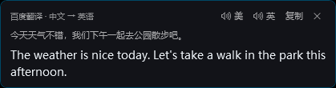

# KeyboardCounter ⌨

一个轻量级的键盘统计工具，实时显示按键次数、打字速度、网络流量和天气信息，并支持鼠标划词翻译。

   

> 🤖 本项目由 AI 智能体开发：
>
> - **v1.0 – v1.5**：由 **Claude Code** 完全自主开发（按键统计、网络/天气、每日统计、布局切换等）
> - **v1.6 – v2.2**：由 **DeepSeek Harness**（DeepSeek-V4 agent）开发（划词翻译、离线词典、翻译缓存、取词方式与白名单、性能修复等）
>
> ⚠️ **二次开发提示**: 本项目没有 `.sln` 解决方案文件，建议让 AI 智能体阅读 [AI_DEV_GUIDE.md](AI_DEV_GUIDE.md) 后进行开发。

## 功能特性

**键盘与系统信息（v1.0 – v1.5）**

- **按键统计** - 统计总按键次数
- **空格/回车统计** - 单独统计空格键和回车键次数及占比
- **打字速度** - 实时计算每分钟按键数 (CPM)
- **网络流量** - 显示上传/下载速度 (KB/s 或 MB/s)
- **下载总量** - 累计下载流量统计 (KB/MB/GB)
- **天气显示** - 根据IP定位显示当前天气图标和温度（5分钟更新）
- **网络供应商** - 显示当前运营商名称（中国电信/联通/移动）
- **每日统计** - 记录每天按键数据，重启后自动恢复
- **智能网络检测** - VPN连接/切换国家时自动更新天气和运营商
- **Emoji 表情** - 根据打字总量动态变化
- **布局切换** - 支持横向和纵向两种显示模式
- **系统托盘** - 最小化到托盘，右键菜单操作
- **开机启动** - 支持设置开机自动启动

**划词翻译（v1.6 – v2.2，DeepSeek Harness 新增）**

- **划词翻译** - 拖动划选 / 双击选词，光标旁气泡显示译文（有道 / 百度接口）
- **离线词典** - 内置 ECDICT + CC-CEDICT，英中双向单词/短语 0.1 ms 级命中，不联网、不耗额度
- **翻译缓存** - 译文存本地 SQLite，重复划词直接命中
- **三级查询** - 离线词典 → 本地缓存 → 在线接口
- **取词方式可切换** - 默认「仅 UIA」（完全不碰剪贴板）/ UIA+剪贴板兜底 / 仅剪贴板
- **取词白名单** - 只为指定程序（如 Typora、微信）放开剪贴板兜底
- **翻译剪贴板热键** - `Ctrl+Alt+T`
- **不抢剪贴板** - 默认模式不会读写剪贴板，截图/粘贴不会被干扰

## 显示效果

### 横向模式 (默认)


### 纵向模式


## Emoji 等级

根据打字总量变化：

| 按键次数 | 表情 | 状态 |
|---------|------|------|
| 0-999 | 😐 | 平淡 |
| 1000-4999 | 🙂 | 微笑 |
| 5000-9999 | 😊 | 开心 |
| 10000-19999 | 😃 | 兴奋 |
| 20000-49999 | 😄 | 愉悦 |
| 50000-99999 | 😆 | 高兴 |
| 100000+ | 🤯 | 震惊 |

## 技术栈

- .NET 8.0
- WPF (Windows Presentation Foundation)
- [Emoji.Wpf](https://github.com/samhocevar/emoji.wpf) - 彩色 Emoji 支持

## 安装运行

### 方式一：下载 Release

从 [Releases](../../releases) 页面下载最新版本

### 方式二：从源码运行

```bash
git clone https://github.com/id270/KeyboardCounter.git
cd KeyboardCounter
dotnet run
```

## 使用说明

- **窗口位置** - 固定在屏幕右下角，可拖动
- **切换布局** - 右键托盘图标 → 布局 → 选择横向/纵向
- **重置计数** - 右键托盘图标，选择"重置计数"
- **开机启动** - 右键托盘图标，勾选"开机启动"
- **划词翻译** - 鼠标拖动划选或双击选词，光标旁自动弹出译文（需先配置接口密钥）
- **退出程序** - 右键托盘图标，选择"退出"

> **托盘图标看不到？** Windows 11 默认会把新图标收进任务栏的「隐藏的图标」（`^`）里：点开它，把「键盘计数器」拖到任务栏上即可；
> 也可以在 设置 → 个性化 → 任务栏 → 其他系统托盘图标 里把它打开。
> 不想折腾托盘也没关系：**在右下角的悬浮窗上点右键**，会弹出和托盘完全相同的菜单。

## 划词翻译

鼠标选中中文或英文 → 光标旁弹出译文气泡，气泡里显示原文、译文、接口名，并提供发音 / 复制 / 关闭按钮。




**三个配置入口**（任选其一）

1. 首次启动且还没填密钥时，程序会自动弹出「划词翻译设置」窗口
2. 在右下角悬浮窗上**点右键** → 划词翻译设置...
3. 右键托盘图标 → 划词翻译 → 翻译接口配置...

**触发方式**

| 方式 | 说明 |
| --- | --- |
| 拖动划选 | 按住左键拖过一段文字后松开 |
| 双击选词 | 双击一个单词（450ms 内两次点击） |
| `Ctrl + Alt + T` | 翻译剪贴板里的文字（划词失效时的备用方式） |

**气泡操作**

- 复制 - 复制译文
- 点击气泡外面、按 `Esc`、或再次划词都会关闭气泡
- 「发音」按钮暂时下线（代码保留，需要时取消注释即可恢复）

**三级查询顺序**

```
① 离线词典（ECDICT）  →  ② 本地缓存（SQLite）  →  ③ 在线接口（有道/百度）
```

| 命中层 | 耗时 | 说明 |
| --- | --- | --- |
| ① ECDICT 离线词典 | **0.1–3 ms** | 英文单词/短语 + **中文词**（CC-CEDICT）；显示音标或拼音 + 多义项 + 词表标签，**不需要联网也不需要密钥** |
| ② 本地缓存 | ~1 ms | 之前用在线接口翻过的词/句子 |
| ③ 在线接口 | 0.4–0.6 s | 词典查不到的句子、新词、以及超过 8 个字的中文长句 |

词典命中时气泡标题显示 `离线词典 · 英 → 中` 或 `离线词典 · 中 → 英`，并额外显示音标/拼音行。
气泡位置贴着**选区最后一行的右下角**（来自 UIA 的选区矩形），不是跟着鼠标跑。

**离线词典（ECDICT）怎么装**

程序不自带词典数据（59 MB，不便塞进仓库），需要先生成一次：

```bash
# 1. 下载两个数据源（UTF-8）
#    ECDICT（英→中，76 万词条）：https://github.com/skywind3000/ECDICT/blob/master/ecdict.csv
#    CC-CEDICT（中→英，12.5 万条）：https://www.mdbg.net/chinese/dictionary?page=cedict
#    解压出 cedict_1_0_ts_utf-8_mdbg.txt
# 2. 转成程序用的 SQLite（第 4 个参数是 CC-CEDICT，可省略）
cd tools/EcdictImporter
dotnet run -c Release -- <ecdict.csv> <输出目录>/dictionary.db 0 <cedict.txt>
# 3. 把生成的 dictionary.db 放到程序目录的 dict\ 下
```

```
<程序目录>\
├── KeyboardCounter.exe
├── dict\dictionary.db          ← 词典（约 75 MB：76 万英文词条 + 20 万中文词条）
└── cache\translate_cache.db    ← 翻译缓存
```

- 数据源：[ECDICT](https://github.com/skywind3000/ECDICT)（**MIT**）、[CC-CEDICT](https://www.mdbg.net/chinese/dictionary?page=cedict)（**CC BY-SA 4.0**，需署名）
- 生成的库只保留必要字段与词形表，并额外建了中文表 `zh(hanzi, traditional, pinyin, english)`，简繁双索引
- 中文词条限 **≤ 8 个字**（再长就按句子处理走在线），英文限 ≤ 120 字符
- 查不到时（句子、新词）自动继续走缓存与在线接口；`dict\` 不存在也能正常工作
- 支持大小写不敏感、词形还原（`perceived → perceive`、`studies → study`）、短语（`give up`、`well-known`）、中文简繁体（`汉语` / `漢語`）
- 实测：英文/中文命中均 **0.09 ms/次**；不想用词典时直接删掉 `dict` 文件夹

**本地缓存（SQLite）**

译文会缓存到程序目录下的 `cache\translate_cache.db`，划词时先查缓存，命中就不再调用接口：

| 项 | 说明 |
| --- | --- |
| 位置 | `<程序目录>\cache\translate_cache.db`（与 exe 同级目录下的 `cache` 文件夹） |
| 键 | 翻译接口 + 原文（两个接口各自独立缓存） |
| 命中效果 | 秒出气泡，标题栏显示「· 缓存」，同时累加该条的使用次数 |
| 容量 | 最多 2 万条，超出后按「最久未使用」淘汰 |
| 容错 | 缓存文件损坏/被占用时自动降级为直连接口，不影响翻译 |
| 清理 | 直接删掉 `cache` 文件夹即可（下次启动会自动重建） |

**翻译接口**

支持有道智云和百度翻译开放平台，二选一，密钥只保存在本机 `config.ini`：

| 接口 | 免费额度 | 申请地址 |
| --- | --- | --- |
| 有道智云 | 新用户赠送 50 元体验金（常见语种约 100 万字符） | <https://ai.youdao.com/> |
| 百度翻译 | 标准版 5 万字符/月；个人认证后高级版 100 万字符/月 | <https://fanyi-api.baidu.com/> |

申请步骤：

1. 有道：注册登录 → 应用管理 → 创建应用（接入方式选 **API**）→ 在"文本翻译"服务里绑定该应用 → 复制 **应用ID** 和 **应用密钥**。
2. 百度：登录并完成实名认证 → 开通"通用文本翻译"→ 在"我的服务"里查看 **APP ID** 和 **密钥**。
3. 右键托盘图标 → 划词翻译 → 翻译接口配置，选择接口、填入密钥，点"测试翻译"确认可用后保存。

> 有道文档：<https://ai.youdao.com/DOCSIRMA/html/trans/api/wbfy/index.html>（签名方式 `sha256(appKey+input+salt+curtime+appSecret)`，`signType=v3`）
> 百度文档：<https://fanyi-api.baidu.com/doc/21>（签名方式 `MD5(appid+q+salt+密钥)`）

**发音**：优先用接口返回的发音地址，其次用有道词典 / 百度翻译网页版的免费发音接口，不需要额外开通语音合成服务。

**取词方式（可切换）**

| 方式 | 是否碰剪贴板 | 适用 |
| --- | --- | --- |
| **仅 UIA（默认）** | **完全不读不写** | 绝大多数场景；绝不会影响截图、剪贴板历史、复制粘贴 |
| UIA + 剪贴板兜底 | 取词瞬间模拟 `Ctrl+C`，取完还原 | 少数不支持可访问性的窗口 |
| 仅剪贴板 | 同上网 | 老式环境 |

托盘右键 → 划词翻译 → 取词方式，或「翻译接口配置」窗口里切换。`config.ini` 里对应 `[Translate] SelectionMode=UiaOnly|UiaWithClipboard|ClipboardOnly`。

**各程序取词支持情况（实测）**

Windows 没有“读取前台程序选中文字”的通用接口，只能依赖目标程序暴露可访问性文本，所以不同程序表现不同：

| 程序 | 引擎 | 取词 | 说明 |
| --- | --- | --- | --- |
| Chrome / Edge / DeepSeek 网页 | Chromium | ✅ | `TextPattern` 在 0–5 层，约 15–60 ms |
| QQ、VS 2026、记事本、任务管理器 | 原生/WPF | ✅ | 标准 UIA |
| Office（Word/Excel） | 原生 | ✅ | 标准 UIA |
| 微信 / WPF、WinForms 自绘控件 | Qt 5.15 等 | ⚠️ 需白名单 | 不实现 UIA 文本接口 |
| Typora、VS Code 等 Electron | Electron | ⚠️ 需白名单 | 只暴露 `Chrome Legacy Window`，树里没有 `TextPattern` |
| 终端（cmd/PowerShell/WT/PuTTY） | — | 🚫 跳过 | `Ctrl+C` 会中断进程 |
| 资源管理器 / 桌面 / 任务栏 | — | 🚫 跳过 | 拖选是复制文件 |
| 管理员权限窗口 | — | 🚫 | Windows 权限隔离（UIPI） |

**取词白名单（让 Typora / 微信 也能用）**

有些程序（Electron 的 Typora、Qt 的微信）只暴露一个「Chrome Legacy Window / 无文本节点」的壳，UIA 读不到选区；另有一批程序（QQ、Chrome、VS）没问题。为了不牺牲安全性，只对指定程序放开剪贴板兜底：

```ini
[Translate]
SelectionMode=UiaOnly
ClipboardFallbackProcesses=typora.exe,WeChat.exe
```

- 名单里的程序：直接用「模拟 Ctrl+C + 读剪贴板」取词（取完还原剪贴板），省掉几秒无用的 UIA 尝试
- 名单外的程序：仍然**完全不碰剪贴板**
- 设置方法：在目标程序里划一次词（会提示取不到），然后托盘右键 → 划词翻译 → **把上一个取词失败的程序加入白名单**
- 想撤销就把 `config.ini` 里对应名字删掉

「仅 UIA」模式下取不到词时会弹一次提示（30 秒内不重复），告诉你加入白名单或改用 `Ctrl+Alt+T`。

**注意**

- 取词优先用 **UI Automation** 直接读选区；默认模式下**完全不碰剪贴板**，不会出现“截图被抢/粘贴出上一次译文”的问题。
- UIA 100 ms 内没返回就和剪贴板那路**并行**跑（仅“UIA + 剪贴板兜底”模式）；超过 140 ms 还没结果会先弹一个「识别中…」占位气泡。
- 「仅 UIA」会先读鼠标位置下的元素，再尝试**焦点控件**，并最多重试 4 次（覆盖选区更新滞后的情况）。
- 终端类窗口（cmd / PowerShell / Windows Terminal / PuTTY）和资源管理器会被跳过：前者 `Ctrl+C` 会中断进程，后者拖选是复制文件。
- 以管理员权限运行的窗口（如任务管理器）无法划词，这是 Windows 的权限隔离限制；可改用 `Ctrl+Alt+T`。
- 若划词没有反应，把 `config.ini` 里的 `[Translate] Debug` 设为 `true`，重启后程序目录会生成 `kc_debug.log`，可据此排查（日志里会分别记录 `uia-only attempt N`、`uia-only hit`、`clipboard capture len=...`）。
- **托盘图标不显示**：Windows 会拒绝给某些目录下的程序注册托盘图标（例如带特殊权限限制的工作目录）。把程序放到普通目录（如 `C:\Users\你\KeyboardCounterApp\`）运行即可；不放也没关系，右键右下角悬浮窗一样能打开全部菜单。程序启动 2.5 秒后还会自动重新注册一次托盘图标。

## 托盘菜单

```
显示窗口
划词翻译设置...
──────────
重置计数
──────────
布局
  ├─ ☑ 横向显示
  └─ ☐ 纵向显示
──────────
划词翻译
  ├─ ☑ 启用划词翻译
  ├─ ──────────
  ├─ 翻译接口
  │    ├─ ☑ 有道翻译
  │    └─ ☐ 百度翻译
  ├─ 取词方式
  │    ├─ ☑ 仅 UIA（不碰剪贴板）
  │    ├─ ☐ UIA + 剪贴板兜底
  │    └─ ☐ 仅剪贴板
  ├─ 把上一个取词失败的程序加入白名单
  ├─ 翻译接口配置...
  └─ 翻译剪贴板 (Ctrl+Alt+T)
──────────
☑ 开机启动
──────────
退出
```

> 这个菜单在**托盘图标**和**右下角悬浮窗右键**上都能弹出，内容相同。

## 配置文件

程序运行时会在同目录下生成 `config.ini` 文件：

```ini
[Display]
Vertical=false

[Translate]
Enabled=true
Provider=Youdao
YoudaoAppKey=你的应用ID
YoudaoAppSecret=你的应用密钥
BaiduAppId=
BaiduAppSecret=
AutoSpeak=true              ; 发音功能暂时关闭，此键保留兼容
MaxLength=600
Debug=false
SelectionMode=UiaOnly       ; UiaOnly / UiaWithClipboard / ClipboardOnly
ClipboardFallbackProcesses=typora.exe,WeChat.exe
Prompted=false
```

## 项目结构

```
KeyboardCounter/
├── KeyboardCounter.csproj    # 项目文件
├── App.xaml                  # 应用程序定义
├── App.xaml.cs               # 应用程序入口
├── MainWindow.xaml           # 主窗口 UI
├── MainWindow.xaml.cs        # 主窗口逻辑
├── KeyboardHook.cs           # 全局键盘钩子
├── MouseHook.cs              # 全局鼠标钩子（划选手势识别）
├── SelectionWatcher.cs       # 划词监听（钩子+轮询，识别拖动/双击）
├── SelectionCapture.cs       # 读取选中文本（UIA 优先，Ctrl+C 兜底）
├── UiaSelectionReader.cs     # 专用 STA 线程跑 UI Automation（带消息泵）
├── UiaSelectionResult.cs     # UIA 选区结果（文本 + 选区末尾坐标）
├── ClipboardSnapshot.cs      # 剪贴板快照（文本/图片/文件，兜底路径用）
├── EcdictDictionary.cs       # 离线词典（ECDICT 英→中 + CC-CEDICT 中→英）
├── TranslatePopup.xaml       # 划词翻译气泡窗口
├── TranslatePopup.xaml.cs
├── ApiConfigWindow.xaml      # 翻译接口配置窗口（有道/百度）
├── ApiConfigWindow.xaml.cs
├── TranslateSettings.cs      # 划词翻译配置（config.ini [Translate]）
├── TranslationCache.cs       # 本地翻译缓存（SQLite，cache\translate_cache.db）
├── ITranslationProvider.cs   # 翻译接口抽象
├── TranslationResult.cs      # 翻译结果
├── TranslationService.cs     # 按配置创建接口实现
├── TranslationException.cs   # 可直接展示的翻译错误
├── YoudaoTranslator.cs       # 有道智云 文本翻译（v3 签名）
├── BaiduTranslator.cs        # 百度翻译 通用文本翻译
├── PronunciationService.cs   # 发音（已暂时关闭，代码保留）
├── LanguageUtil.cs           # 语种判断与文本清洗
├── ScreenGeometry.cs         # 屏幕坐标与 WPF 坐标换算
├── DebugTrace.cs             # 可选调试日志
├── IniConfig.cs              # INI配置文件处理
├── DailyStats.cs             # 每日统计数据管理
├── tools/EcdictImporter/     # 词典导入工具（ecdict.csv + cedict → dictionary.db）
├── README.md                 # 中文说明文档
├── README_EN.md              # English README
├── AI_DEV_GUIDE.md           # AI Development Guide
├── config.ini                # 运行时配置文件
├── dict\dictionary.db        # 离线词典（需自行生成，约 75 MB）
├── cache\translate_cache.db  # 翻译缓存（自动生成）
└── daily_stats.json          # 每日统计数据文件（自动生成）
```

## 系统要求

- Windows 10 或更高版本
- .NET 8.0 Runtime

## 更新日志

> v1.6 及之后的条目由 **DeepSeek Harness** 完成；v1.0 – v1.5 由 **Claude Code** 完成。

### v2.2（DeepSeek Harness）
- ✨ 新增取词白名单：`ClipboardFallbackProcesses`（如 `typora.exe,WeChat.exe`）——只有名单里的程序用剪贴板兜底，其它程序依旧零剪贴板接触
- ✨ 托盘菜单新增「把上一个取词失败的程序加入白名单」，一键设置；白名单程序直接走剪贴板路径，省掉 2 秒无效的 UIA 尝试
- 🔧 UIA 祖先遍历上限从 5 层提到 12 层，并"某层选区为空继续向上找"——修复 Chrome/Electron 里大量文本节点取不到词的问题
- 📄 README 补充各程序取词支持情况与白名单操作方式

### v2.1
- ✨ 新增「取词方式」：**仅 UIA（默认，完全不碰剪贴板）** / UIA + 剪贴板兜底 / 仅剪贴板，托盘菜单与配置窗口都能切
- ✨ 「仅 UIA」增加焦点控件兜底与最多 4 次重试，覆盖选区更新延迟；取不到时给出一次性提示
- 🔧 从此默认不会读写剪贴板：截图、剪贴板历史、复制粘贴都不再被干扰（实测取词前后剪贴板序列号不变）

### v2.0
- ✨ 离线词典补上 **CC-CEDICT 中→英**（12.5 万条，简繁双索引），中文词也能 0.1ms 出结果
- 🔧 气泡改为贴着**选区末尾**显示（UIA 选区矩形），不再跟着鼠标跑到远处
- 🔧 截图场景不再被抢剪贴板：识别截图浮层（系统截图 / Snipaste / PixPin / ScreenSketch 等）并直接跳过；同时加了序列号保护——取词期间若别人写了剪贴板就不还原

### v1.9
- 🔧 划词不再破坏剪贴板：取词前快照、取完还原（文本 / 图片 / 文件列表都能还原，截图不再被吞）
- 🔧 取词提速：UIA 100 ms 内没结果就与剪贴板路径并行；超过 140 ms 先显示「识别中…」占位气泡
- 🔧 离线词典启动预热，首次查询不再有冷启动开销

### v1.8
- ✨ 新增离线词典（ECDICT 76 万词条）：单词/短语优先查本地，显示音标、多义项、词表标签，0.1~3 ms 出结果
- ✨ 查询改为三级：离线词典 → 本地缓存 → 在线接口
- 🔧 鼠标钩子移到独立线程，界面再忙也不会拖慢系统鼠标（新增 `inputDelay` 指标）
- 🔧 气泡窗口启动时预热，首次划词不再有额外建窗开销

### v1.7
- ✨ 新增本地翻译缓存（SQLite）：`cache\translate_cache.db`，先查缓存、命中不请求接口，气泡显示「· 缓存」
- ✨ 取词改为 UI Automation 直接读选区（不碰剪贴板），读不到才退回 `Ctrl+C`
- 🔧 修复划词后短暂卡顿：取词工作不再占用鼠标钩子回调（回调耗时从数百毫秒降到 0.5 ms）
- 🔧 修复托盘图标在部分目录下不注册的问题，并新增悬浮窗右键菜单作为备用入口
- 🚫 暂时关闭发音功能（代码保留，需要时取消注释恢复）

### v1.6
- ✨ 新增划词翻译：拖动划选 / 双击选词后，光标旁气泡显示译文
- ✨ 新增发音（英美音 / 中文），翻译后自动朗读
- ✨ 新增有道智云、百度翻译两种接口，可在托盘菜单里切换并配置密钥（未填写密钥时气泡会提示去配置）
- ✨ 新增 `Ctrl+Alt+T` 翻译剪贴板，作为划词失效时的备用入口
- 🔧 划词读取后会还原剪贴板内容；终端窗口、资源管理器自动跳过

### v1.5
- ✨ 新增每日输入统计，记录 total/space/enter，重启后自动恢复
- ✨ 新增智能网络检测，VPN连接/切换国家时自动更新天气和运营商
- ✨ 新增 IP 变化检测（每30秒轮询），VPN内切换国家自动触发更新
- 🔧 网络供应商显示优化：正确显示"中国电信/联通/移动"
- 🔧 网络变化时延迟等待+重试机制，避免过渡状态显示错误
- 🔧 天气更新间隔从10分钟调整为5分钟
- 🐛 修复纵向模式网络速度显示小数位丢失问题

### v1.4
- ✨ 新增天气显示（图标+温度）
- ✨ 新增网络供应商显示
- ✨ 新增下载总量统计
- ✨ 新增横向/纵向布局切换
- ✨ 新增INI配置文件持久化
- 🔧 纵向布局动态宽度适配

### v1.1
- ✨ 新增开机启动功能

### v1.0
- 🎉 首次发布

## License

MIT License

---

**English**: [README_EN.md](README_EN.md)
