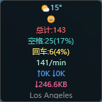
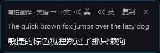

# KeyboardCounter ⌨

A lightweight Windows desktop widget that shows **keystroke count, CPM typing speed, network traffic and weather** in real time — plus **selection translation** with an offline dictionary (ECDICT + CC-CEDICT), a local SQLite cache, and Youdao / Baidu online translation.

   

> 🤖 This project is developed by AI agents:
>
> - **v1.0 – v1.5**: fully built by **Claude Code** (keystroke stats, network/weather, daily statistics, layouts …)
> - **v1.6 – v2.2**: built by **DeepSeek Harness** (a DeepSeek agent) — selection translation, offline dictionary, translation cache, selection modes & whitelist, performance fixes
>
> ⚠️ **Note for Developers**: This project has no `.sln` file. Let AI agents read [AI_DEV_GUIDE.md](AI_DEV_GUIDE.md) before making changes.

## Features

**Keyboard & system info (v1.0 – v1.5)**

- **Keystroke Statistics** – Total key count
- **Space/Enter Statistics** – Individual counts with percentages
- **Typing Speed** – Characters per minute (CPM)
- **Network Traffic** – Upload/download speed (KB/s or MB/s)
- **Total Download** – Cumulative download traffic (KB/MB/GB)
- **Weather Display** – Weather icon and temperature from IP geolocation (every 5 min)
- **ISP Name** – Current provider (China Telecom/Unicom/Mobile)
- **Daily Statistics** – Persisted per day, restored on restart
- **Smart Network Detection** – Refreshes weather/ISP on VPN or IP change
- **Emoji Expression** – Changes with total keystrokes
- **Layout Switching** – Horizontal and vertical modes
- **System Tray** – Minimize to tray with context menu
- **Auto Start** – Launch on Windows startup

**Selection translation (v1.6 – v2.2, added by DeepSeek Harness)**

- **Selection translation** – Drag-select or double-click a word; a bubble pops up next to the text (Youdao / Baidu)
- **Offline dictionary** – Bundled ECDICT + CC-CEDICT, en→zh and zh→en in ~0.1 ms, no network, no quota
- **Translation cache** – Local SQLite cache for previously translated text
- **Three-tier lookup** – offline dictionary → local cache → online API
- **Selectable capture mode** – `UIA only` (default, **never touches the clipboard**) / UIA + clipboard fallback / clipboard only
- **Capture whitelist** – allow the clipboard fallback for specific apps only (e.g. Typora, WeChat)
- **Clipboard hotkey** – `Ctrl+Alt+T` translates the clipboard content
- **Clipboard-safe by default** – screenshots and copy/paste are never disturbed

## Screenshots

### Horizontal Mode (Default)


### Vertical Mode



### Translation bubble



## Emoji Levels

| Keystrokes | Emoji | Status |
|------------|-------|--------|
| 0-999 | 😐 | Neutral |
| 1000-4999 | 🙂 | Smile |
| 5000-9999 | 😊 | Happy |
| 10000-19999 | 😃 | Excited |
| 20000-49999 | 😄 | Joyful |
| 50000-99999 | 😆 | Grinning |
| 100000+ | 🤯 | Mind Blown |

## Tech Stack

- .NET 8.0 / WPF
- [Emoji.Wpf](https://github.com/samhocevar/emoji.wpf) – color emoji
- [Microsoft.Data.Sqlite](https://learn.microsoft.com/dotnet/standard/data/sqlite/) – dictionary and translation cache
- UI Automation (UIA) for reading the selection — no clipboard by default

## Installation

### Option 1: Download Release

Download from the [Releases](../../releases) page and unzip anywhere (avoid read-only / heavily restricted folders).

### Option 2: Run from Source

```bash
git clone https://github.com/id270/KeyboardCounter.git
cd KeyboardCounter
dotnet run
```

Build a distributable folder:

```bash
dotnet publish -c Release -r win-x64 --self-contained false -o publish
```

The offline dictionary is **not** part of the repository (≈75 MB). Generate it once:

```bash
# 1. download the data sources (UTF-8)
#    ECDICT:     https://github.com/skywind3000/ECDICT/blob/master/ecdict.csv
#    CC-CEDICT:  https://www.mdbg.net/chinese/dictionary?page=cedict  (extract the .txt)
# 2. build dictionary.db
cd tools/EcdictImporter
dotnet run -c Release -- <ecdict.csv> <out>/dictionary.db 0 <cedict.txt>
# 3. copy dictionary.db into <app folder>/dict/
```

Without `dict/dictionary.db` the app still works — it just goes straight to the cache/online tiers.

## Usage

- **Window Position** – Bottom-right corner, draggable
- **Switch Layout** – Right-click tray icon → Layout → Horizontal/Vertical
- **Reset Count** – Right-click tray icon → Reset Count
- **Auto Start** – Right-click tray icon → Auto Start
- **Selection translation** – Drag-select text or double-click a word (needs an API key first)
- **Settings** – Right-click the floating overlay (or the tray icon) → "Selection translation settings…"
- **Exit** – Right-click tray icon → Exit

> On Windows 11 the tray icon often lands in the **hidden icons** flyout (`^`) — drag it onto the taskbar, or simply right-click the floating overlay, which opens the same menu.

## Selection Translation

Select Chinese or English text → a bubble appears at the end of the selection with the source text, translation, provider and buttons.

**How it is triggered**

| Trigger | Description |
| --- | --- |
| Drag-select | Press, drag over text, release |
| Double-click | Two clicks within 450 ms, ≤ 6 px apart |
| `Ctrl + Alt + T` | Translate whatever is in the clipboard |

**Three-tier lookup**

| Tier | Latency | Notes |
| --- | --- | --- |
| ① Offline dictionary (ECDICT / CC-CEDICT) | **0.1–3 ms** | Words and short phrases, shows phonetics/pinyin + multiple senses, no network, no API key |
| ② Local cache (SQLite) | ~1 ms | Anything translated online before |
| ③ Online API (Youdao / Baidu) | 0.4–0.6 s | Sentences, new words, Chinese longer than 8 chars |

The bubble header shows `离线词典 · 英 → 中` / `离线词典 · 中 → 英` for dictionary hits, `· 缓存` for cache hits. The bubble is anchored to the **selection's last line** (from the UIA selection rectangle), not to the mouse.

**Which apps can be captured (measured)**

Windows has no universal “give me the selected text” API — the target app must expose accessibility text. Hence:

| App | Engine | Capture | Notes |
| --- | --- | --- | --- |
| Chrome / Edge / Electron pages | Chromium | ✅ | `TextPattern` at depth 0–5, 15–60 ms |
| QQ, Visual Studio 2026, Notepad, Task Manager | native / WPF | ✅ | standard UIA |
| Office (Word/Excel) | native | ✅ | standard UIA |
| WeChat (微信) | Qt 5.15 | ⚠️ whitelist | does not implement UIA text |
| Typora, VS Code (Electron) | Electron | ⚠️ whitelist | only exposes `Chrome Legacy Window`, no `TextPattern` |
| Terminals (cmd/PowerShell/WT/PuTTY) | — | 🚫 skipped | `Ctrl+C` would interrupt the process |
| Explorer / desktop / taskbar | — | 🚫 skipped | dragging copies files |
| Elevated windows | — | 🚫 | Windows UIPI isolation |

**Capture modes (switchable)**

| Mode | Clipboard | Use for |
| --- | --- | --- |
| **UIA only (default)** | never read or written | almost everything; screenshots and clipboard history stay untouched |
| UIA + clipboard fallback | briefly simulates `Ctrl+C`, then restores | windows without accessibility text |
| Clipboard only | same | legacy environments |

Tray menu → 划词翻译 → 取词方式, or the “Selection translation settings” dialog. `config.ini`: `[Translate] SelectionMode=UiaOnly|UiaWithClipboard|ClipboardOnly`.

**Capture whitelist (makes Typora / WeChat work)**

```ini
[Translate]
SelectionMode=UiaOnly
ClipboardFallbackProcesses=typora.exe,WeChat.exe
```

- Listed apps: captured through “simulate `Ctrl+C` + read clipboard”, then the clipboard is restored (and the UIA attempts are skipped, saving ~2 s)
- Everything else: **still never touches the clipboard**
- Setup: select text once in the target app (a hint pops up), then tray menu → 划词翻译 → **“Add the last failed app to the whitelist”**
- Remove a name from `config.ini` to revoke it

**Notes**

- The bubble is shown after 140 ms if capture is slow (`识别中…` placeholder), so it never looks dead.
- Elevated windows cannot be captured at all (UIPI); use `Ctrl+Alt+T` for those.
- If capture fails, `[Translate] Debug=true` writes `kc_debug.log` next to the exe with `uia-only attempt N`, `uia-only hit`, `clipboard capture len=...` lines.

## Tray Menu

```
Show Window
Selection translation settings...
──────────
Reset Count
──────────
Layout
  ├─ ☑ Horizontal
  └─ ☐ Vertical
──────────
划词翻译 (Selection translation)
  ├─ ☑ Enable
  ├─ ──────────
  ├─ Provider
  │    ├─ ☑ Youdao
  │    └─ ☐ Baidu
  ├─ Capture mode
  │    ├─ ☑ UIA only (no clipboard)
  │    ├─ ☐ UIA + clipboard fallback
  │    └─ ☐ Clipboard only
  ├─ Add the last failed app to the whitelist
  ├─ Provider settings...
  └─ Translate clipboard (Ctrl+Alt+T)
──────────
☑ Auto Start
──────────
Exit
```

> The same menu is available by right-clicking the floating overlay.

## Configuration

`config.ini` next to the executable:

```ini
[Display]
Vertical=false

[Translate]
Enabled=true
Provider=Youdao
YoudaoAppKey=your-app-id
YoudaoAppSecret=your-app-secret
BaiduAppId=
BaiduAppSecret=
AutoSpeak=true              ; pronunciation is currently disabled, kept for compatibility
MaxLength=600
Debug=false
SelectionMode=UiaOnly       ; UiaOnly / UiaWithClipboard / ClipboardOnly
ClipboardFallbackProcesses=typora.exe,WeChat.exe
Prompted=false
```

## Project Structure

```
KeyboardCounter/
├── KeyboardCounter.csproj    # Project file
├── App.xaml / App.xaml.cs    # Application entry
├── MainWindow.xaml(.cs)      # Main window, timers, tray menu, translation wiring
├── KeyboardHook.cs           # Global keyboard hook
├── MouseHook.cs              # Global mouse hook (own thread + message loop)
├── SelectionWatcher.cs       # Gesture detection, capture modes, whitelist
├── SelectionCapture.cs       # Read selection (UIA first, Ctrl+C fallback)
├── UiaSelectionReader.cs     # Dedicated STA thread (message pump) for UIA calls
├── UiaSelectionResult.cs     # Selection text + end-of-selection anchor
├── ClipboardSnapshot.cs      # Clipboard snapshot (text/image/files) for fallback
├── EcdictDictionary.cs       # Offline ECDICT + CC-CEDICT lookup
├── TranslatePopup.xaml(.cs)  # Selection translation bubble
├── ApiConfigWindow.xaml(.cs) # Provider settings dialog
├── TranslateSettings.cs      # config.ini [Translate]
├── TranslationCache.cs       # SQLite translation cache
├── ITranslationProvider.cs   # Provider abstraction
├── TranslationResult.cs
├── TranslationService.cs     # Provider factory
├── TranslationException.cs
├── YoudaoTranslator.cs       # Youdao v3 signature
├── BaiduTranslator.cs        # Baidu general text translation
├── PronunciationService.cs   # Pronunciation (currently disabled, code kept)
├── LanguageUtil.cs           # Language detection / text cleanup
├── ScreenGeometry.cs         # Screen px ↔ DIP conversion
├── DebugTrace.cs             # Optional debug log (kc_debug.log)
├── IniConfig.cs              # INI parser/writer
├── DailyStats.cs             # Daily counters (JSON)
├── tools/EcdictImporter/     # Dictionary importer (ecdict.csv + cedict → dictionary.db)
├── dict/dictionary.db        # Offline dictionary (generate yourself, ~75 MB)
├── cache/translate_cache.db  # Translation cache (auto-created)
└── daily_stats.json          # Daily statistics (auto-created)
```

## Requirements

- Windows 10 or later
- .NET 8.0 Runtime

## Changelog

> Entries from v1.6 onwards were made by **DeepSeek Harness**; v1.0 – v1.5 by **Claude Code**.

### v2.2
- ✨ Capture whitelist (`ClipboardFallbackProcesses`) — only the listed apps may use the clipboard fallback
- ✨ Tray item “Add the last failed app to the whitelist”; whitelisted apps skip the UIA attempts (saves ~2 s)
- 🔧 UIA ancestor walk raised from 5 to 12 levels, and an empty selection on one level now continues upward — fixes capture in Chrome/Electron text nodes that sit at depth 5
- 📄 Documented per-app capture support and the whitelist workflow

### v2.1
- ✨ Capture modes: UIA only (default, **no clipboard I/O**) / UIA + clipboard fallback / clipboard only
- ✨ UIA-only gained a focused-element fallback and up to 4 retries
- 🔧 Verified that a capture leaves the clipboard sequence number untouched

### v2.0
- ✨ CC-CEDICT added for offline zh→en (12.5万 entries, simplified + traditional keys)
- 🔧 Bubble anchored to the selection rectangle instead of the mouse position
- 🔧 Screenshot overlay classes are skipped; clipboard restore is skipped when someone else wrote the clipboard in the meantime

### v1.9
- 🔧 Clipboard snapshot/restore (text, image, file list); parallel capture paths; “identifying…” placeholder

### v1.8
- ✨ Offline ECDICT dictionary (768 739 words, 196 374 inflected forms); three-tier lookup
- 🔧 Mouse hook moved to its own thread (no more system-wide mouse stutter); popup warm-up

### v1.7
- ✨ SQLite translation cache; UIA-first capture; pronunciation disabled (code kept)

### v1.6
- ✨ Selection translation: drag-select / double-click, bubble with phonetic or pinyin, Youdao + Baidu providers, `Ctrl+Alt+T`

### v1.5
- ✨ Daily keystroke statistics; smart network/IP change detection; 5-minute weather refresh; ISP display fixes

### v1.4
- ✨ Weather, ISP, total download, horizontal/vertical layouts, INI persistence

### v1.1
- ✨ Auto start on boot

### v1.0
- 🎉 Initial release

## License

MIT License

---

**中文**: [README.md](README.md)
